## Prototype ready — refined battle screen

**Open it:** `file:///C:/Users/benjm/AppData/Local/Temp/opencode/fb-battle-prototype/.prototype/battle-refined/index.html` (single self-contained file; double-click works).

**Branch:** [`prototype/battle-refined`](https://github.com/SixStringBny/fieldbound/tree/prototype/battle-refined/.prototype/battle-refined) · **Commit:** `da356ba` · **README:** [states, measurements and the engine-surface gap](https://github.com/SixStringBny/fieldbound/blob/prototype/battle-refined/.prototype/battle-refined/README.md)

States: `?state=turn|draw|play|damage|shift|intent|detail|focus|reduced|log` · `?chrome=0` hides the bar for screenshots · `?motion=reduce` forces the reduced-motion branch. Arrow keys cycle states; Escape closes the sheet/drawer and returns focus.

The same seeded frame in every state: Ember starter vs Cinder Warden on turn 4. Enemy 16/30 with 4 defense and Weaken 1, Ember field, player 30/40, 3 energy, five real cards, intent of two Cinder Jabs (3 damage each after Weaken) and an Ash Guard (4 defense). Real content and the existing placeholder SVGs; no production code is imported.

### What the prototype locks

- **Table (1280x800):** arena `minmax(0, 1fr)` plus an 18rem sticky log rail; enemy → field → player axis; the hand fan spans both columns below the rail; the board is `100svh` and the rail is the only table scroller. At 1024–1279px the rail is 15rem and the fan/cards compress.
- **Phone (390x844 and 375x667):** 44px header with Run overview and Leave; compact enemy band; field roundel; scrollable 108px card rack; player merged into the sticky control bar with health, defense, energy, End Turn and Log; latest log line above the bar; the full intent expands inline.
- **Tablet portrait (768x1024):** the phone composition expanded — single column, both panels, all five cards visible, inline intent, drawer log. **Landscape (1024x768):** the table composition with the compact vertical rhythm.
- **Cards and detail:** parchment face with cost seal, stone-framed art under the warm scrim, name/type/value, field bonus and pierce badges. Table fan is ±4° with no overlapping hit boxes. Detail is a 460px sheet at table width and an 88svh bottom sheet below it; closing returns focus to the invoking card.
- **Field:** brass-ringed roundel at the centre of the etched arena; phone collapses the cycle to the current element plus “beats Frost”.
- **Feedback frames:** draw (Expose pinned as DRAWN), play (Cinder Jab in flight over the field with TARGET on the enemy), damage (`−5`, base 3 / Ember +2 / defense ignored), shift (Neutral → Ember with the intent recomputed), intent reveal, focus ring and keyboard hint, and the reduced-motion static strip.
- **Hard constraints:** every visible control is at least 44px; secondary text 9.97:1, muted 6.86:1 and stat values 15.73:1 against the warm slate; parchment text 6.98–13.02:1; the focus ring is gold with a white inner edge and dark halo so it reads on both surfaces; the OS reduced-motion preference and the toggle both take the hard branch.

### Measured

At **390x844, 375x667, 768x1024, 1024x768 and 1280x800**, in all ten states: `documentElement.scrollWidth == innerWidth`, `scrollHeight == innerHeight`, no console or page errors, and no control below 44px. Only the hand rack and the log rail/drawer scroll. The 375px intent-expanded frame and the 768px tablet frame still fit without page scroll.

### State the implementation must invent beyond the engine surface

The engine returns a new `BattleState` with no animation event stream, so these frames mix engine facts with presentation state. The full list is in the README; the blockers are:

1. **Draw identity and burn.** Diff `instanceId`s to know which card entered the hand. The engine burns an overdraw silently; a burn beat needs a diff or a presentation event.
2. **Play identity.** The log gives `cardId`, not the instance that left the hand; diff hand → discard to animate the right copy when duplicates exist.
3. **Damage attribution and ordering.** The log gives one settled damage effect; the UI must split/group per-hit numbers. Incoming previews come from `PlanStep.damage`/`totalDamage`.
4. **Field and status before/after.** Capture the previous field and counters (or read the log effects) for the shift frame and the “Weaken spent” beat.
5. **Intent expansion/reveal.** Open state, the recomputed badge and the inline phone list are UI; the engine supplies the plan, costs, totals and `lethal`.
6. **Hand scroll, lift, selection, sheet, drawer and focus return.** All UI state; the sheet must remember the invoking card.
7. **Affordability styling, motion timings, reduced-motion mapping, latest-line strip and announcements.** Derived presentation contracts; the log itself stays non-live.

The recommendation is a small presentation derivation beside the existing battle-log derivation — engine rules, snapshots and the log contract stay untouched.

### Screenshots

Attached in order: table/phone turn, draw, play, damage, shift, intent, detail, focus, reduced; then the phone log drawer.

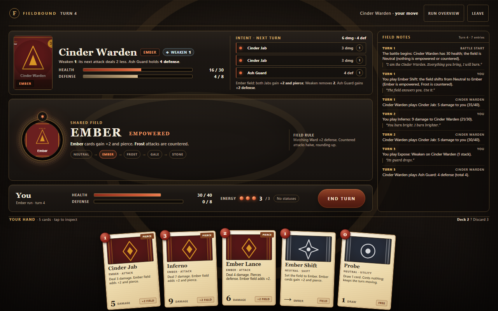
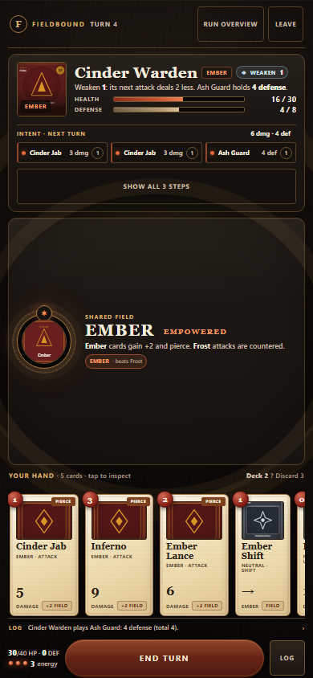
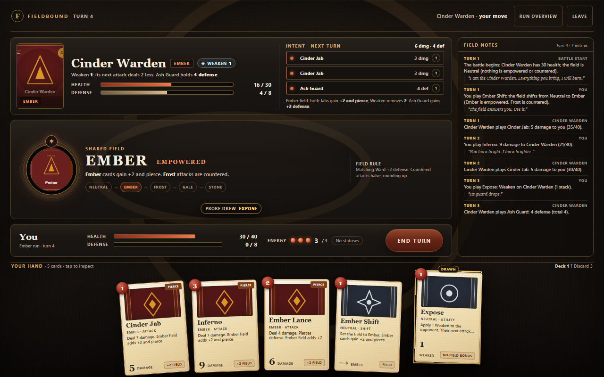
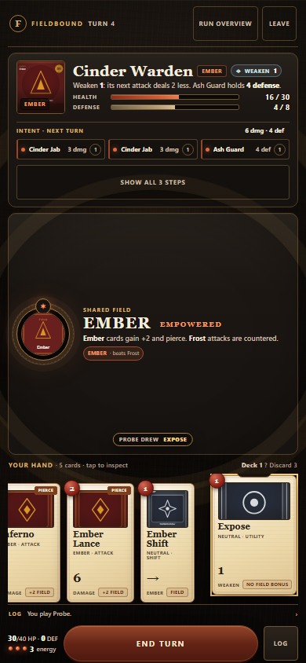
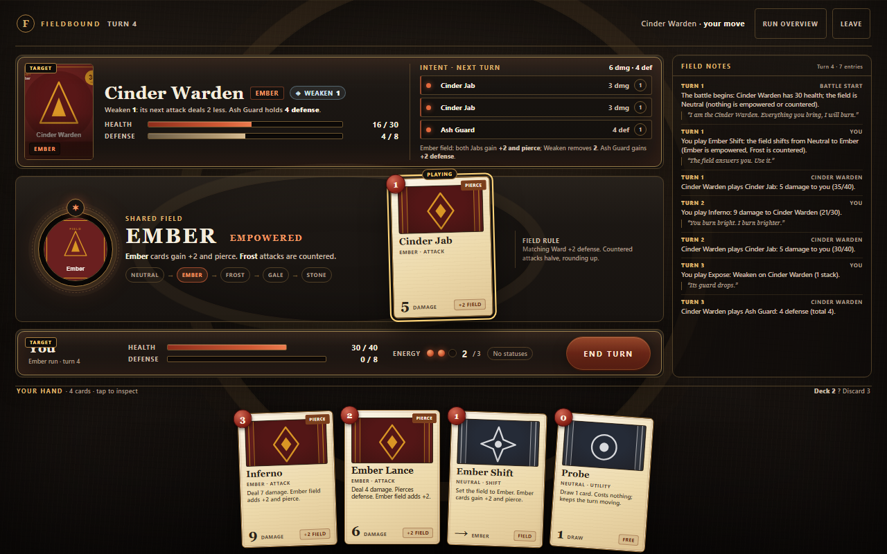
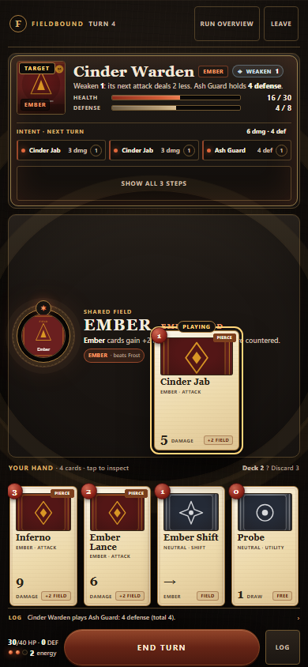
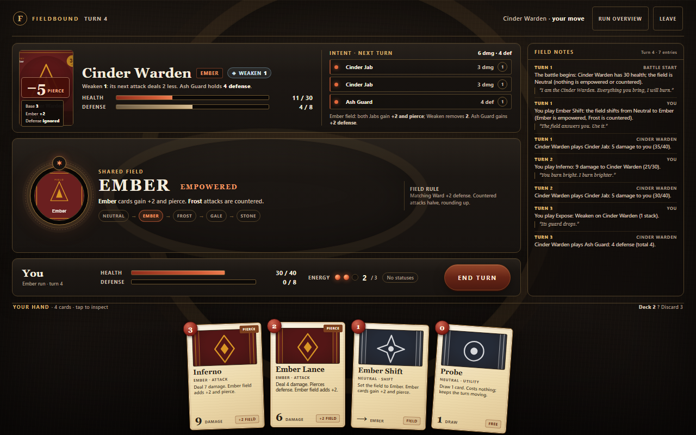
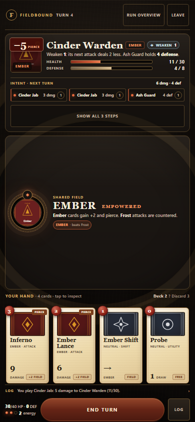
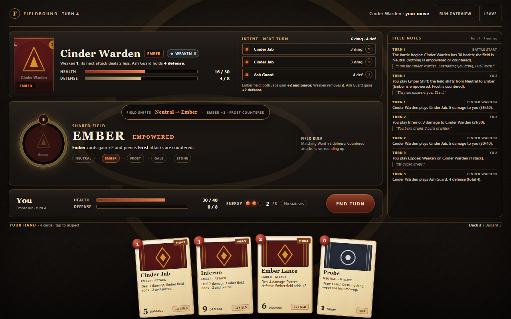
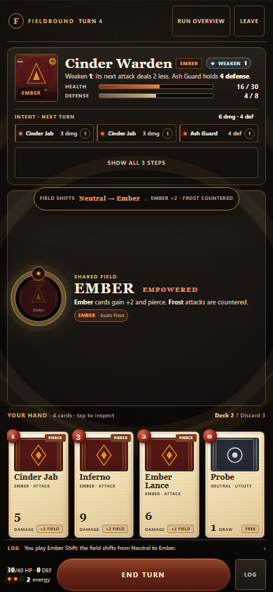
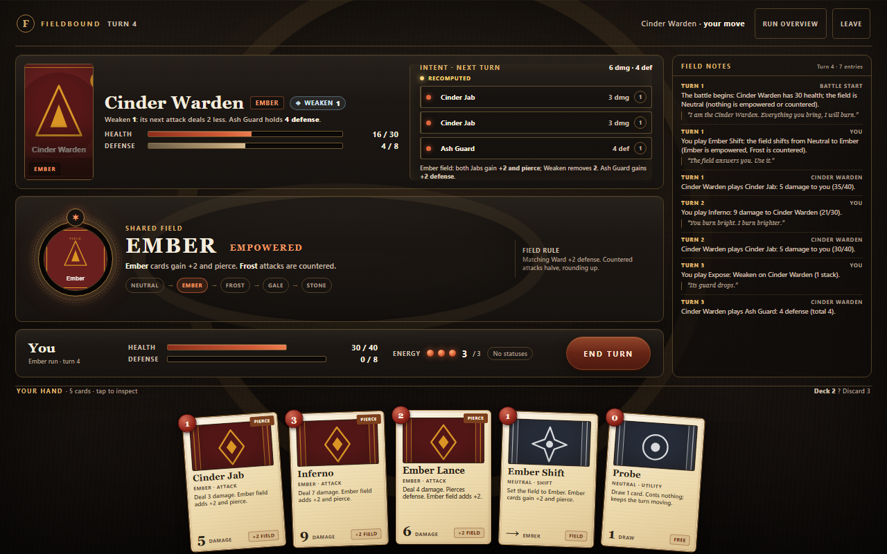
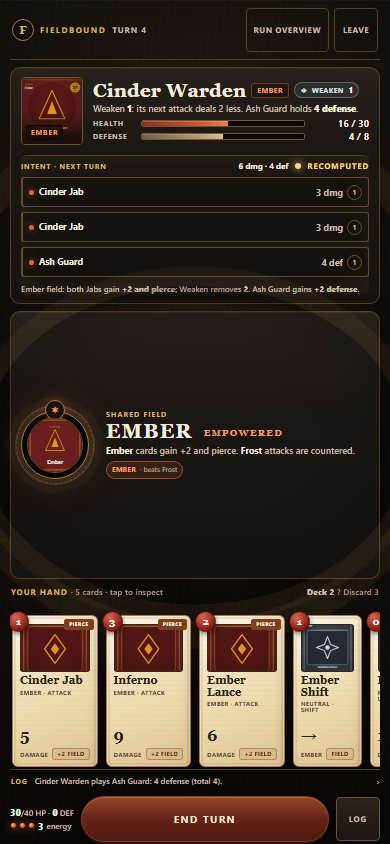
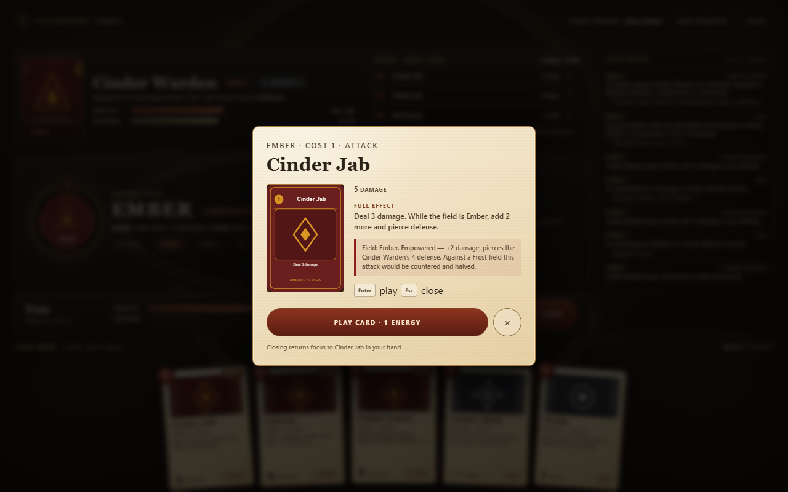
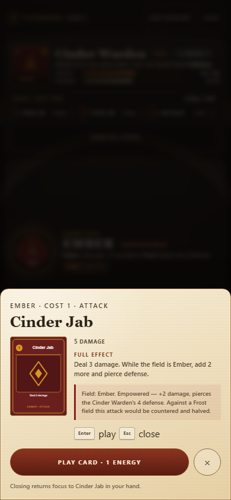
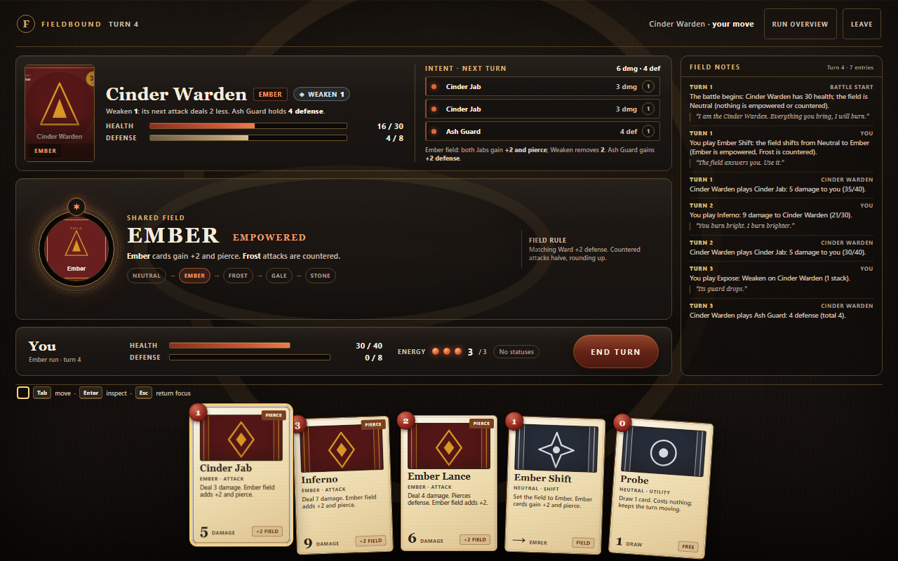
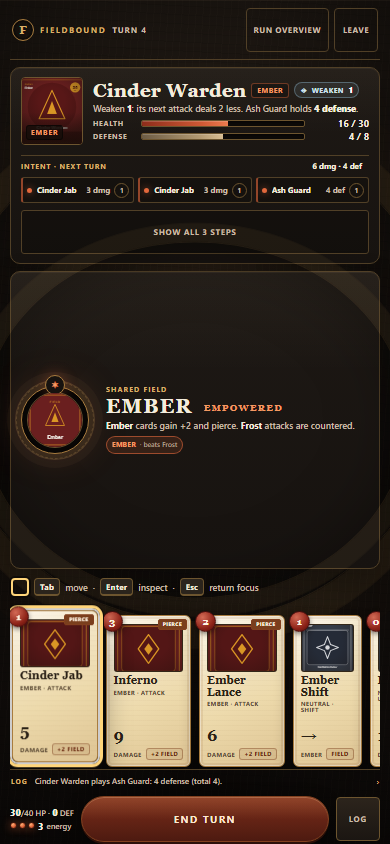
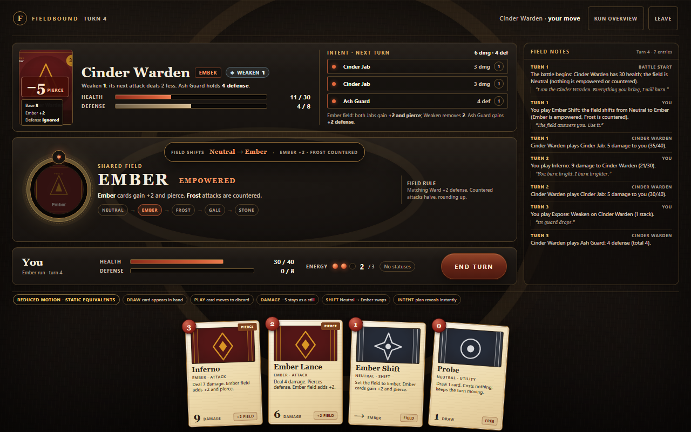
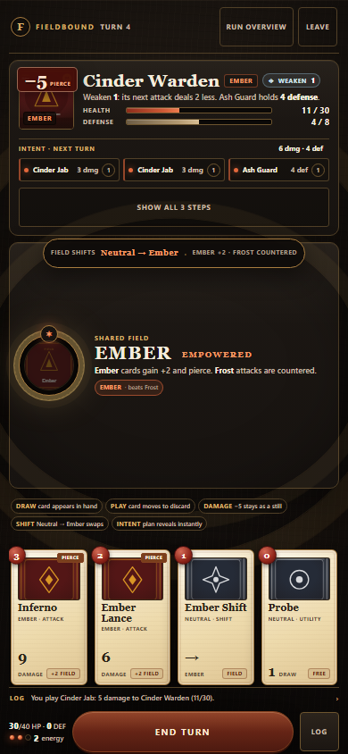
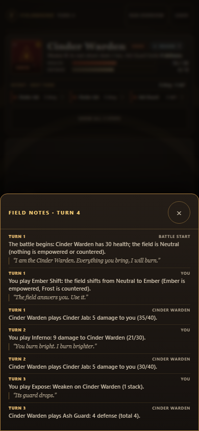
